# LAPORAN EVIDENCE TUGAS PEMROGRAMAN WEB (MINGGU 10)
## Implementasi PostgreSQL & Prisma ORM pada REST API Express

- **Mata Kuliah**: Pemrograman Web
- **Dosen**: Anas Machfudy Al Junaedi S.T., M.T., M.Sc.
- **Topik**: PostgreSQL, ORM & Prisma Client (CRUD Products)

---

## 1. Deskripsi Perubahan Arsitektur (Before vs After)

Pada tugas sebelumnya (Minggu 9 / Tugas 1), data produk masih disimpan di dalam array memori Node.js (`let products = [...]`) di dalam controller. Hal tersebut memiliki kelemahan mendasar: ketika server Express di-restart, seluruh perubahan data (tambah, edit, hapus) akan hilang dan kembali ke nilai awal.

Pada tugas ini (Minggu 10 / Tugas 2), REST API ditingkatkan menggunakan **Prisma ORM** yang terhubung langsung ke database relasional **PostgreSQL**:
- **Penyimpanan**: Data tersimpan permanen (persistent) di PostgreSQL.
- **Validasi & Penanganan Error**: Menangani input kosong, tipe data tidak valid (misal harga berupa teks), serta error entitas tidak ditemukan (`404 Not Found`).
- **Endpoint**: Mendukung lengkap metode `GET` (semua & by ID), `POST` (create), `PUT` (update dengan `id` di body sesuai spesifikasi tugas), dan `DELETE` (delete by ID).

---

## 2. Riwayat Atomic Commit

Sesuai instruksi tugas, format commit yang digunakan adalah `type(tugas-x): xxxx` dan bersifat **atomic** (1 commit untuk 1 perubahan/fitur):

| Hash Commit | Pesan Commit | Penjelasan Perubahan |
|:---|:---|:---|
| `c881b1f` | `feat(tugas-1): initial express product api` | Struktur awal API tugas 1 (in-memory array) |
| `036190b` | `feat(tugas-2): add dependency` | Penambahan `@prisma/client` dan `prisma` CLI |
| `bbee156` | `feat(tugas-2): setup database` | Konfigurasi schema Prisma, instance client, dan migrasi SQL |
| `8ade458` | `feat(tugas-2): implement get products with prisma` | Mengubah endpoint `GET /products` & `GET /products/:id` ke database |
| `2805493` | `feat(tugas-2): implement create product with prisma` | Mengubah endpoint `POST /products` ke database dengan validasi |
| `03567bf` | `feat(tugas-2): add update product feature with prisma` | Menambahkan endpoint `PUT /products` dengan `id` di body |
| `3f8ba09` | `feat(tugas-2): add delete product feature with prisma` | Menambahkan endpoint `DELETE /products/:id` |

---

## 3. Evidence Skenario Pengujian API & Perubahan Database (Before - After)

### Bagian A: Skenario POST (Create Data) & Perubahan Database

#### 1. Database BEFORE POST
Tabel `Product` di database PostgreSQL dalam kondisi kosong (`0 of 0 records`).
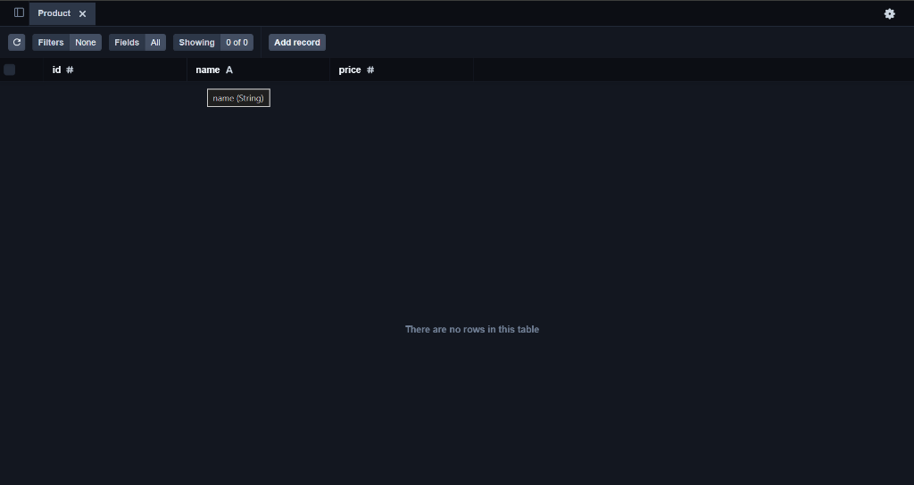

#### 2. POST /products - Produk 1 (Success - 201 Created)
Membuat produk pertama `"Buku Tulis"` dengan harga `15000`.
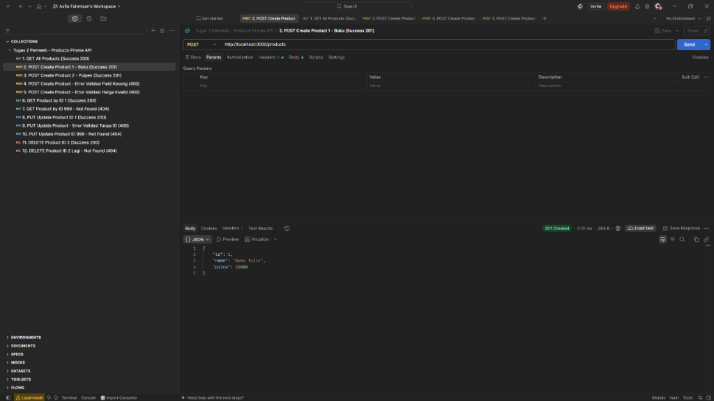

#### 3. POST /products - Produk 2 (Success - 201 Created)
Membuat produk kedua `"Pulpen"` dengan harga `5000`.
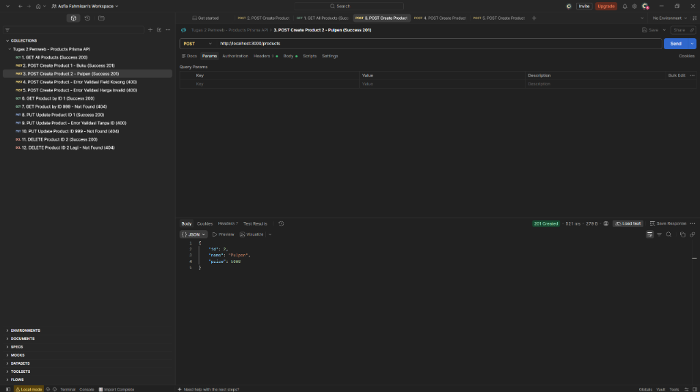

#### 4. POST /products - Validasi Error Field Kosong (400 Bad Request)
Request `POST` dengan `name: ""` ditolak dengan response pesan error yang sesuai.
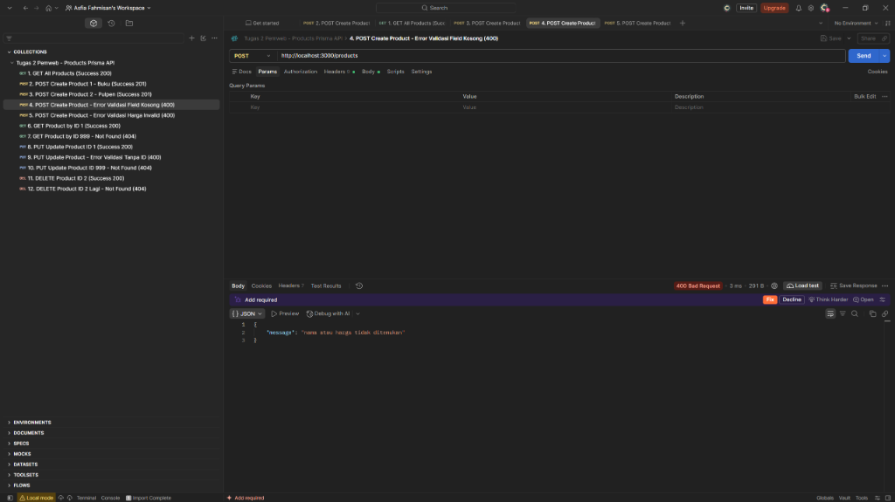

#### 5. POST /products - Validasi Error Tipe Data Harga (400 Bad Request)
Request `POST` dengan `price: "lima ribu"` ditolak dengan status `400 Bad Request`.
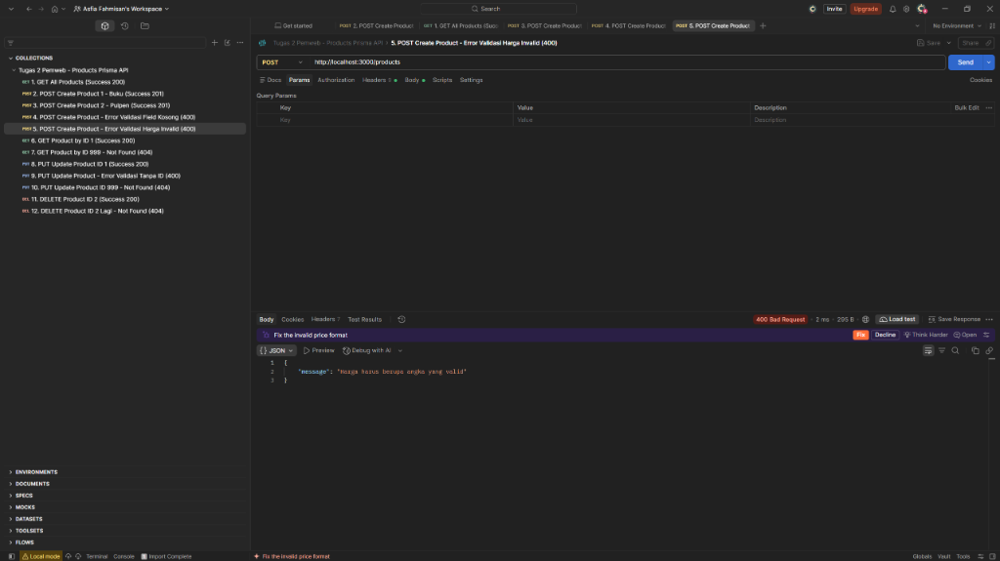

#### 6. Database AFTER POST
Tabel `Product` di PostgreSQL berhasil bertambah 2 baris data (`id: 1` Buku Tulis & `id: 2` Pulpen).
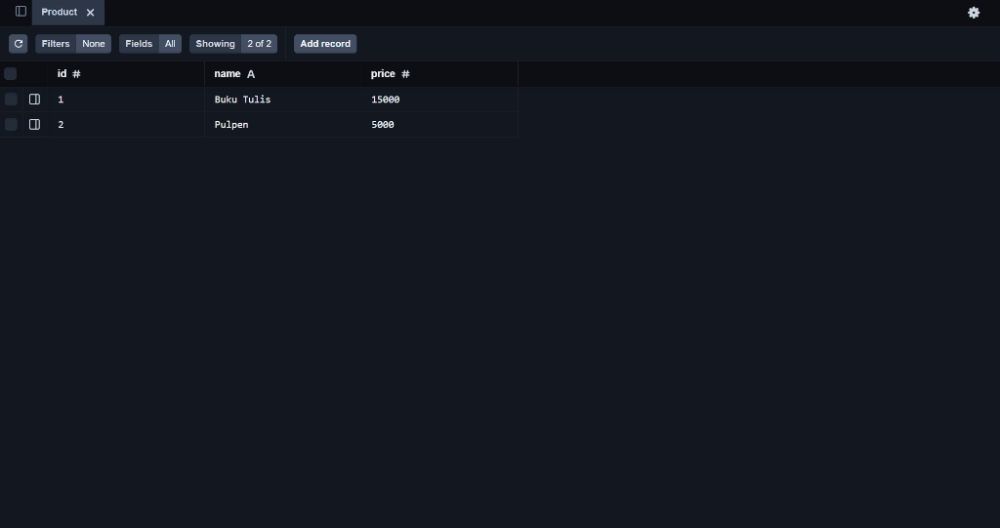

---

### Bagian B: Skenario GET (Menampilkan Data)

#### 7. GET /products - Menampilkan Seluruh Produk (Success - 200 OK)
Menampilkan seluruh data produk yang tersimpan di PostgreSQL.
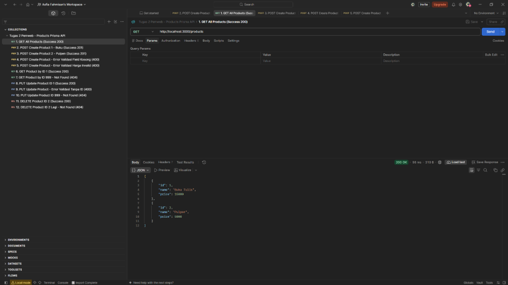

#### 8. GET /products/:id - Menampilkan Produk Berdasarkan ID (Success - 200 OK)
Menampilkan produk spesifik dengan `id: 1`.
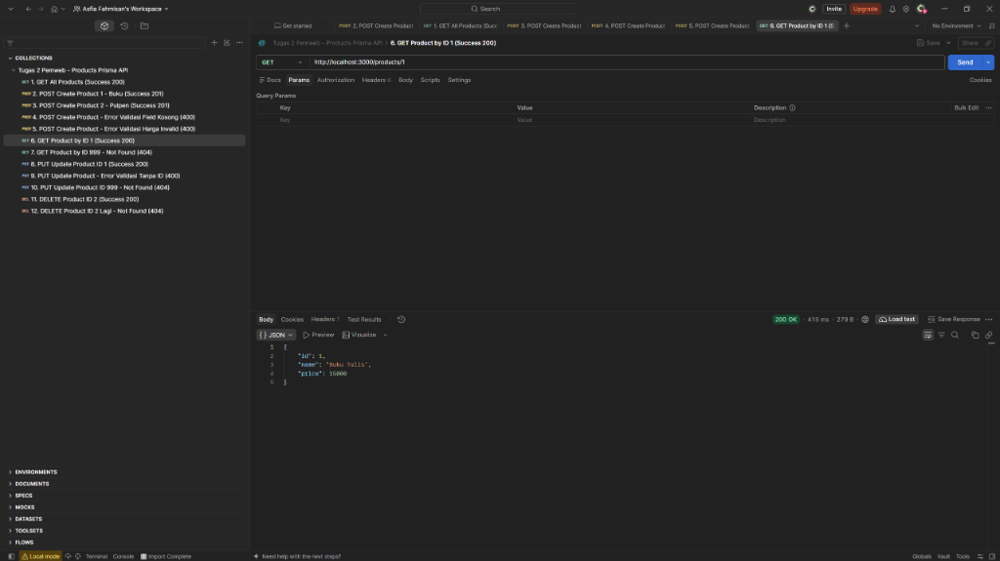

#### 9. GET /products/:id - ID Tidak Ditemukan (404 Not Found)
Request `GET /products/999` menghasilkan status `404 Not Found` dengan pesan `"Produk tidak ditemukan"`.
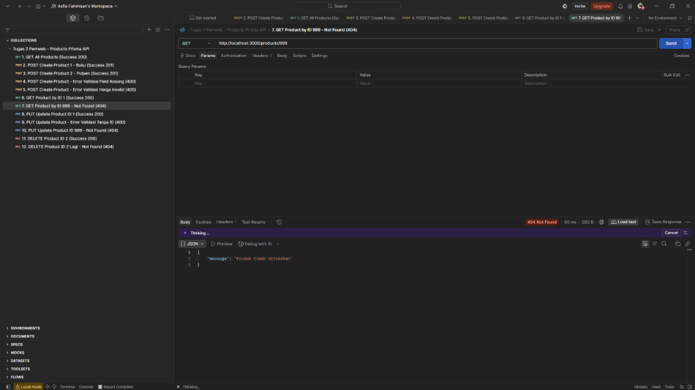

---

### Bagian C: Skenario PUT (Update Data) & Perubahan Database

#### 10. Database BEFORE PUT
Dapat merujuk pada kondisi data sebelum diedit, yaitu `id: 1` masih bernama `"Buku Tulis"` dengan harga `15000`.

#### 11. PUT /products - Update Produk ID 1 (Success - 200 OK)
Body JSON memuat `id`, `name`, dan `price` baru (`"Buku Tulis Campus"`, harga `18000`). Data berhasil diupdate.
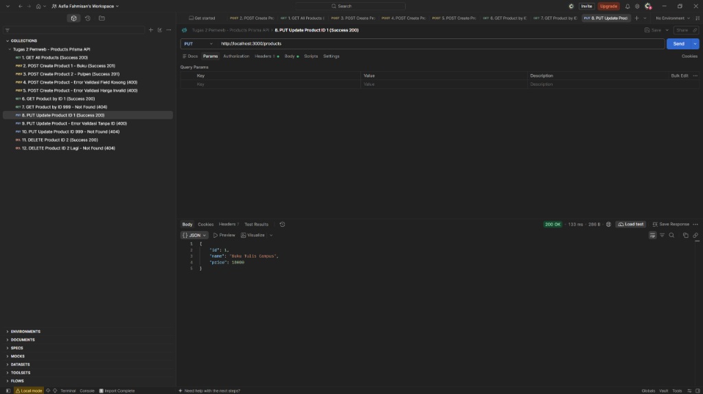

#### 12. PUT /products - Validasi Error Tanpa ID (400 Bad Request)
Request `PUT` tanpa mencantumkan properti `id` di body menghasilkan status `400 Bad Request`.
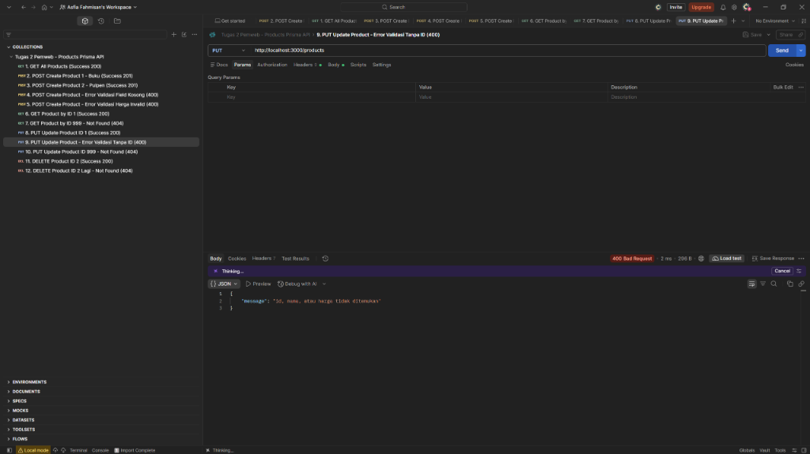

#### 13. PUT /products - ID Tidak Ditemukan (404 Not Found)
Request `PUT` dengan `id: 999` menghasilkan status `404 Not Found`.
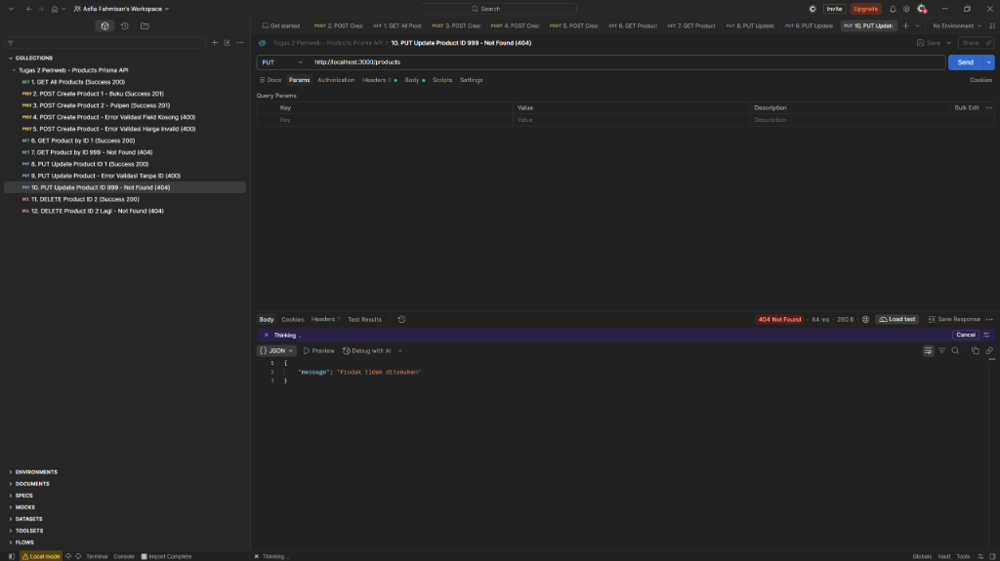

#### 14. Database AFTER PUT
Tabel `Product` di PostgreSQL terupdate secara *real-time*: baris `id: 1` kini bernama `"Buku Tulis Campus"` dan harga `18000`.
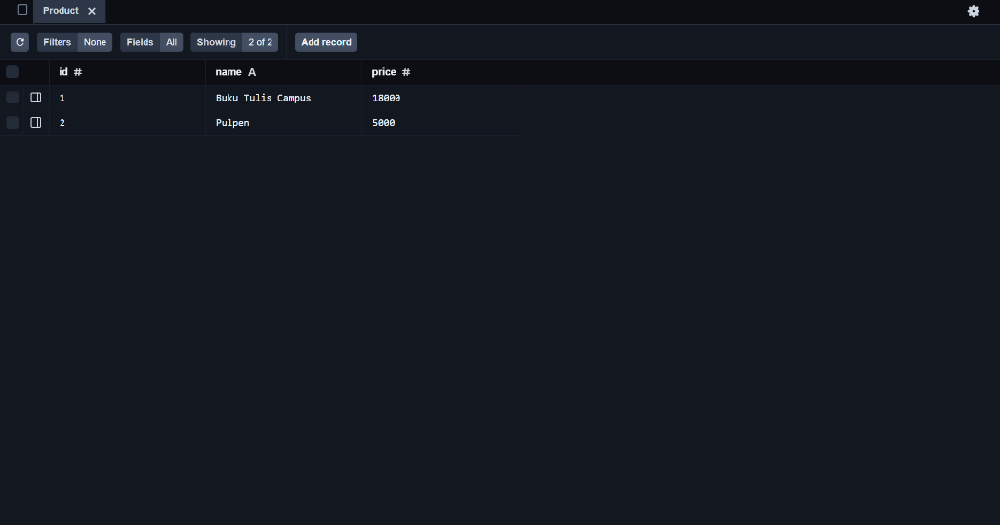

---

### Bagian D: Skenario DELETE (Menghapus Data) & Perubahan Database

#### 15. DELETE /products/:id - Hapus Produk ID 2 (Success - 200 OK)
Menghapus produk `"Pulpen"` (`id: 2`). Response mengembalikan status `200 OK` dan detail data yang dihapus.
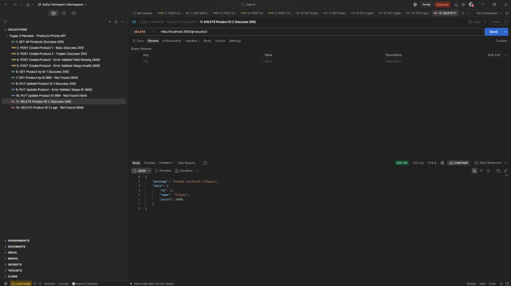

#### 16. DELETE /products/:id - Hapus ID yang Sudah Terhapus (404 Not Found)
Memanggil kembali `DELETE /products/2` menghasilkan status `404 Not Found` karena data sudah tidak ada di database.
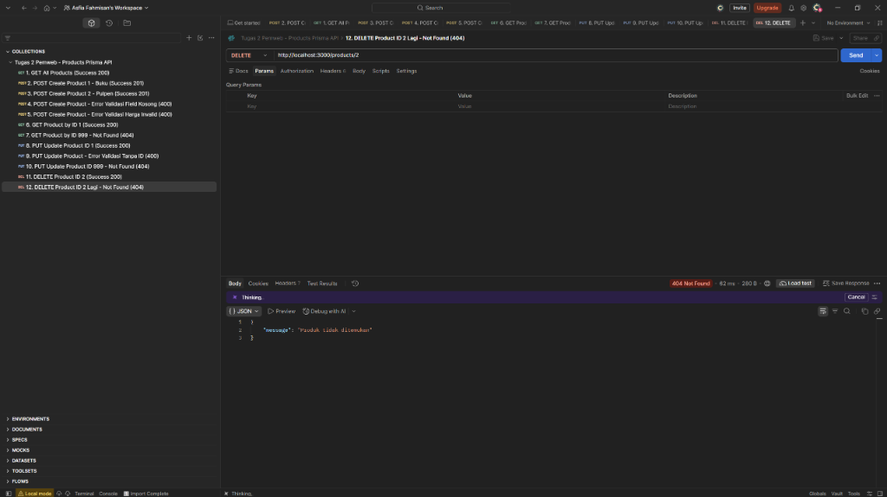

#### 17. Database AFTER DELETE
Tabel `Product` di PostgreSQL kini hanya menyisakan `1 of 1 records` (`id: 1`), membuktikan bahwa data `id: 2` telah berhasil terhapus secara permanen dari database.
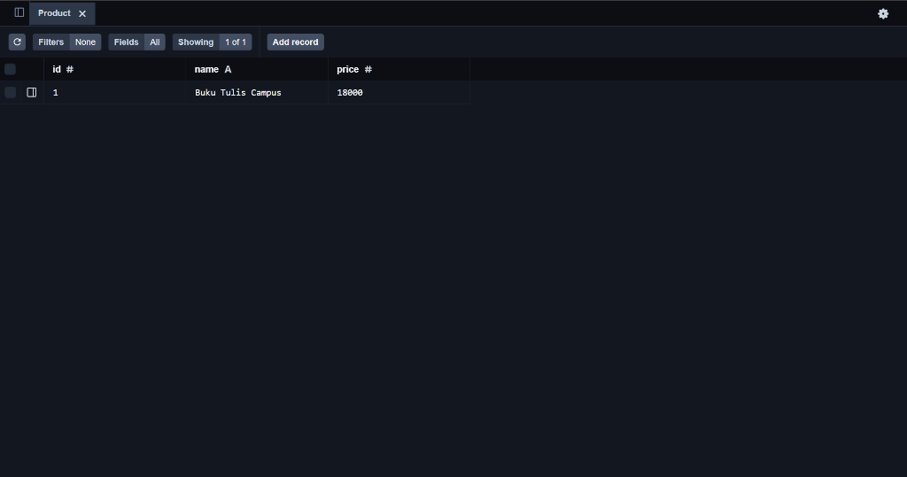
